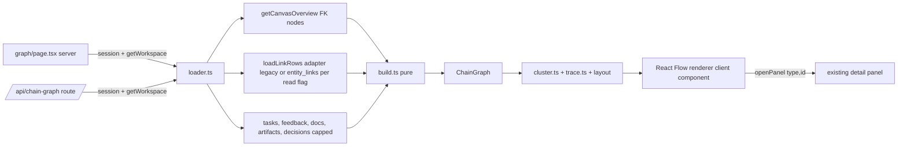
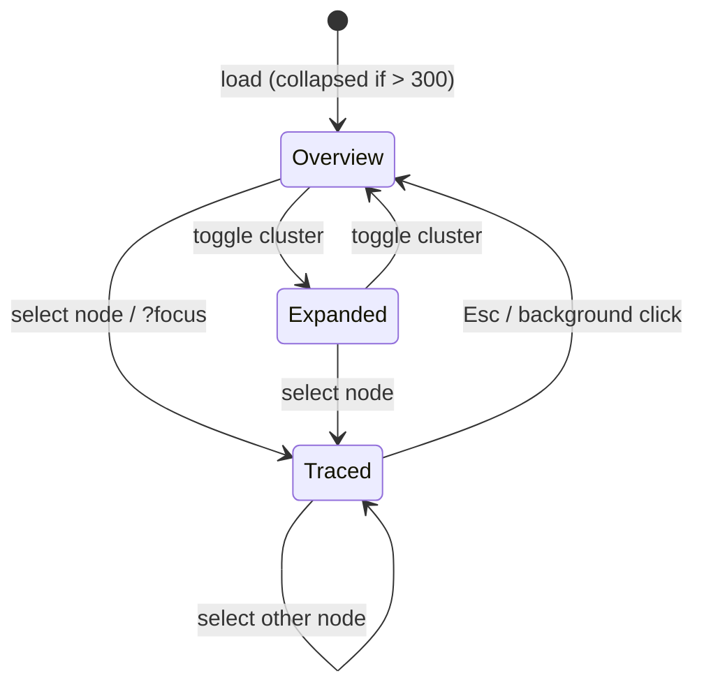

# Design: Chain graph ("cloud" view of Compass object chains)

**Status:** Phase 2 implemented (PR #452, flag-gated spike); phase 3 in progress. Sections below describe the design; section 10 records what was actually built and where it differs.
**Author:** Rick + Claude
**Base:** `origin/main` @ `f3684e30`
**Reference prototype:** `compass-graph-proto/index.html` (mock data, vanilla SVG, hand-rolled force layout). Concept approved by Rick: semantic zoom (dots, key labels, full detail), group-by clouds (objective / type / status) with collapsible clusters, click-to-trace upstream and downstream chain, hide-unrelated, type filter, search, drag-to-pin.

> **ADR routing.** Per `CLAUDE.md`, architecture decisions live in Compass Docs under "Architecture Decisions", not in `docs/decisions/`. This file therefore holds the decision table below. If Rick wants the renderer and route decisions recorded formally, create a child Doc there and route it with `request_decision` (`subjectType: "DOC"`). This design does not self-certify any status.

> **Next.js caveat.** `AGENTS.md` says this Next has breaking changes, and the repo pins `next@16.3.6`. No `node_modules` exists in this checkout or any compass worktree, so the repo's own `node_modules/next/dist/docs/` could not be read. The conventions below were checked against the docs shipped in a sibling project's `next@16.2.3` (`01-app/02-guides/lazy-loading.md`, `03-api-reference/03-file-conventions/page.md`): `searchParams` and `params` are Promises; `next/dynamic` with `ssr: false` is only allowed inside a Client Component. **Re-verify against 16.3.6 after `pnpm install`, before Phase 1 code.**

## 1. Problem

The OST is a chain: Objective, Key Result, Opportunity, Solution, Assumption, Experiment, Roadmap item, with Tasks, Feedback, Docs, Artifacts and Decisions hanging off it. Today you can see one hop at a time (detail panel relation lists, Discovery boards) or build a static tree into a JSON Canvas doc ("Build tree", `lib/canvas-tree.ts`). Neither answers "what is this experiment ultimately for, and what is blocked downstream of it?" across a workspace of hundreds of objects.

Success: from any object, one click shows its full upstream and downstream chain in context; from the workspace, a PM can see which objectives are crowded with unvalidated assumptions without opening ten boards.

**Non-goals (v1):** editing links from the graph, shared or persisted layouts, cross-workspace graphs, more than a few thousand objects, mobile-first interaction (must degrade to the outline list, see section 5).

## 2. What is actually available today

### 2.1 entity_links state on `origin/main`

All seven registered link types are merged on `origin/main` (`lib/links/registry.ts`):

| Link type | Edge | Source of truth for reads today |
|---|---|---|
| `EXPERIMENT_INFORMED_BY_STUDY` | Experiment to Research study | `entity_links` only (no legacy table) |
| `SOLUTION_TARGETS_KEY_RESULT` | Solution to KR | legacy `SolutionKeyResultLink`; mirrored + 098 backfill merged |
| `OPPORTUNITY_TARGETS_OBJECTIVE` | Opportunity to Objective | legacy `OpportunityObjectiveLink`; mirrored + 095 backfill |
| `OPPORTUNITY_TARGETS_KEY_RESULT` | Opportunity to KR (to-one) | legacy `Opportunity.linkedKeyResultId`; mirrored + 095 |
| `ARTIFACT_ATTACHED_TO_SOLUTION`, `ARTIFACT_SUPPORTS_DECISION` | Artifact to Solution / Decision | legacy `ArtifactLink`; mirrored + 096 |
| `TASK_REFERENCES` | Task to Opp/Sol/Roadmap/Obj/KR/Doc/Exp/Feedback/Decision | legacy `TaskLink`; mirrored + 097 |

Critical nuance: the legacy-backed types are in `mode: "mirror"`, and the read flip is controlled per family by `COMPASS_ENTITY_LINKS_{SOLUTION_KR,OPPORTUNITY,ARTIFACT,TASK}_READ` (`off | shadow | on`, default **off**, merged as PR A #441 with "no behaviour change"). While a flag is off, the legacy table is the source of truth and `entity_links` is a shadow. **A graph that reads `entity_links` directly today would be wrong or empty for those types.** It must read through the same seam the flag flips (see 4.2).

Branches: the `feat/entity-links-{artifact,opp-objective,solution-kr,task}` branches are the pre-squash histories of PRs #430, #433, #434 and #436, all merged (`git cherry` shows `+` only because of squash-merge; I did not tree-diff each). The detached checkout at `42994f6b` is the tip of `feat/entity-links-task`, 13 commits behind `origin/main`. `feat/experiment-study-links-v2` is 6 commits ahead of main and I did not determine whether it is superseded by merged #425; treat as open. There is no new link type to wait for.

### 2.2 Edge availability by object chain

| Edge | Available via | Notes |
|---|---|---|
| Objective to KR | native FK `KeyResult.objectiveId` | |
| KR to Opportunity | native FK `Opportunity.linkedKeyResultId` | single parent |
| Objective to Opportunity | typed link (legacy table now, `entity_links` after flip) | CLASSIC preset hides LEGACY-origin ones |
| Opportunity to Solution | native FK `Solution.opportunityId` | |
| Solution to KR | typed link (as above) | closes a cycle (KR, Opp, Solution, KR) |
| Solution to Assumption | native FK `Assumption.solutionId` | |
| Assumption to Experiment | native FK `Experiment.assumptionId` | nullable; independent experiments exist |
| Roadmap item parents | native FKs `solutionId`, `experimentId`, `opportunityId`, `keyResultId`, `feedbackId` | multi-parent DAG leaf |
| Feedback to Opportunity | native FK `FeedbackItem.opportunityId` | |
| Task to anything | `TaskLink` (legacy now) / `TASK_REFERENCES` | many-to-many |
| Doc | `Doc.roadmapItemId` (positioning briefs only) and task references | **most Docs have no chain edge** |
| Decision (ReviewRequest) | `TASK_REFERENCES`, `ARTIFACT_SUPPORTS_DECISION`, `RoadmapItem.nowDecisionRecordId`; `ReviewRequest.subjectType/subjectId` is a generic subject pointer | which `subjectType` values map to chain objects not verified; open question |
| Experiment to Study | `entity_links` only | PM-interview studies must stay hidden (see `loadSummaryRows`) |

**Existing precedent to reuse, not rebuild:** `lib/canvas/data.ts` (`getCanvasOverview`) already loads the OST plus roadmap items for a workspace with workspace-scoped, flat queries, and `lib/canvas/edges.ts` (`buildCanvasEdges`) already derives primary/secondary/link edges purely, including the thinking-model rule for Objective-Opportunity links and cycle avoidance. Its header says semantic zoom, lazy per-KR fetch and drag-to-pin were explicitly out of scope, and `CanvasNodePosition` has no writer. The old read-only `/canvas` screen was retired (it now redirects to Docs), so this is the natural successor, not a duplicate. Tasks, Feedback, Docs, Artifacts and Decisions are not in `CanvasOverview` and are the net-new loading work.

## 3. Decisions

| # | Decision | Recommendation | Main alternative | Revisit if |
|---|---|---|---|---|
| D1 | Route | New top-level section `graph`: `/[org]/[ws]/graph?focus=<TYPE>:<id>` | Tab inside Discovery/OKRs; revive `/canvas` | Rick wants it inside an existing nav item |
| D2 | Data | New read-model `lib/chain-graph/` (server loader + pure builder), reuse `getCanvasOverview` and `buildCanvasEdges` | Query `entity_links` directly | All four read flags are `on` in prod |
| D3 | Delivery | Server component loads workspace graph (capped); Route Handler for focused subgraph | Pure client fetch only | Initial payload exceeds budget |
| D4 | Renderer | `@xyflow/react` shell + framework-agnostic pure layout/cluster/trace modules, gated by a perf spike | Custom SVG (port prototype); Canvas 2D | Spike fails the 1,000-element budget |
| D5 | Force layout | `d3-force` (new small dependency) run to settle off the render path | Hand-rolled (prototype); `elkjs` (already a dep) | Rick rejects a new dependency |
| D6 | Persistence | v1 none; pins are session-only | `CanvasNodePosition` shared; per-user table; localStorage | Users ask to keep arrangements |

### D1. Route and entry points

- **Workspace view:** `app/[orgSlug]/[workspaceSlug]/graph/page.tsx`. Add `"graph"` to `TOP_LEVEL_SECTIONS` in `lib/workspace-nav.ts` (a test fails if it drifts from the route tree) so workspace switching lands on it.
- **Deep link / per-object entry:** `?focus=<TYPE>:<id>` (UUID or display ID, resolved by `resolveWorkItem` like `/api/panels/entity`), mirroring the existing `?detail=<type>:<id>` convention. Focus means: select, trace, and center that node. Other view state (`group`, `hide`, `types`, `q`) also lives in search params so views are shareable and survive refresh. Plain `useSearchParams`; no `nuqs`.
- **Entry from objects:** a "View chain" action in the shared detail panel header (`components/panels/`) that links to `graph?focus=...`. It reaches all panel-backed types at once. Per-board card affordances are out of scope.
- **Sidebar:** do **not** add a nav item in v1; ship behind a workspace-visible flag and entry via the panel only. Adding a ninth primary nav entry is a product call (open question Q1).
- Node click in the graph traces the chain (prototype behavior). "Open details" in the side list calls `openPanel(type, id)`; the panel provider is already mounted in the workspace layout, so graph and panel compose with no new plumbing.
- Why not Discovery tab: the chain spans OKRs, roadmap, tasks and feedback, so it belongs to no one board. Why not revive `/canvas`: the name is now bound to JSON Canvas docs and the redirect exists for old bookmarks.

### D2. Read-model and endpoint shape

Module layout (all under `lib/chain-graph/`, none under `lib/links/`, which is reserved for the link service and has a guard test on naming `EntityLink`):

```
loader.ts   server: (prisma, workspaceId, scope) -> GraphSnapshot   // only file that touches the DB
build.ts    pure:   GraphSnapshot -> ChainGraph                      // nodes, edges, truncation
trace.ts    pure:   (ChainGraph, id) -> { upstream, downstream, edges }
cluster.ts  pure:   (ChainGraph, groupBy, collapsed) -> visible nodes + aggregated edges
```

```
ChainNode  { key: "<TYPE>:<uuid>", type: LinkableEntityType, id, displayId?, title,
             status, group: { objectiveId | null }, archived: boolean }
ChainEdge  { from: key, to: key, kind: "primary"|"secondary"|"link"|"task"|"feedback", weight? }
ChainGraph { nodes, edges, truncated: { byType: Record<type, {shown, total}> } | null, generatedAt }
```

- **Edge source rule.** Native FK edges come from `buildCanvasEdges` as is. Typed-link and task-link edges come from a single adapter `loadLinkRows(tx, workspaceId, family)` that returns legacy rows now and `entity_links` rows when that family's `getLinkReadMode` is `on`, so this feature never needs a second change when the flip happens. In `shadow` mode serve legacy (same rule as every other reader). The adapter is the only place that knows.
- **Tenant isolation.** Every query starts with `where: { workspaceId }` (or the existing relation filter for KR / Assumption: `objective: { workspaceId }`, `solution: { workspaceId }`), and both ends of every edge must be in the loaded node set or the edge is dropped (same fail-closed rule as `resolveEndpoints` and `buildLinkEdges`). NULL-workspace Solution and Objective rows never match. The page and the Route Handler both gate on session plus `getWorkspace(org, ws, userId)` before the loader runs (copy the `/api/panels/entity` two-layer pattern). PM-interview studies, restricted-visibility records and archived objects are excluded by the same predicates the detail and link read models use.
- **Pagination is the wrong tool for a graph;** a partial page of nodes yields dangling edges and a misleading chain. Use scope plus caps instead:
  - `scope=workspace` returns the structural OST (Objective through Experiment, roadmap items) up to per-type caps and a global cap of **1,500 nodes**, ordered deterministically (`sortOrder`, `createdAt`, `id`), archived excluded by default.
  - Tasks, feedback, docs, artifacts and decisions are **not** in the workspace payload by default. They are returned when the type filter enables them, subject to their own caps, because tasks and feedback can outnumber the OST by 10x.
  - `scope=focus&focus=<TYPE>:<id>&depth=<n>` returns the BFS neighborhood (default depth 6, hard max 12, same global cap) so a chain from a deep link is complete even when the workspace view was truncated.
  - Truncation is reported (`truncated.byType`) and shown in the UI ("showing 1,500 of 2,310; narrow with filters or focus"). Never silent.
- **Endpoint.** Initial workspace graph is loaded in the server component (no client round trip, no spinner). `GET /api/chain-graph?orgSlug&workspaceSlug&scope=focus|workspace&focus&depth&types` serves focus fetches and type toggles. It is added because the client needs it for expansion; if Phase 1 ships workspace-scope only, defer the route to Phase 3. Response shape is `ChainGraph`. Rate and size follow the `/api/panels` precedent (session cookie, no public access).
- **Query style.** Flat `findMany` plus in-memory join (as `getCanvasOverview` documents) because DSQL has no FKs and deep `include` is slow at this size. Chunk `in: ids` lists as `lib/typed-links.ts` does.
- **Not in the response:** descriptions, comments, scores. The side panel fetches those through the existing `/api/panels/entity` route on selection.

### D3. Renderer: `@xyflow/react` vs custom SVG vs Canvas

| Option | Pros | Cons |
|---|---|---|
| **A. `@xyflow/react` (recommended, gated)** | Already a dependency (docs canvas editor); built-in pan/zoom, viewport culling (`onlyRenderVisibleElements`), focusable nodes, keyboard semantics, selection, minimap, fit-view; custom node components can read zoom for LOD; `ViewportPortal` for cloud halos | Per-node DOM and React reconciliation; per-tick position updates at 1k nodes are expensive; no native concept of convex "clouds" or force simulation; library CSS must be reconciled with tokens |
| B. Custom SVG (port prototype) | Total control; prototype already proves the interaction; no library CSS | Re-implement pan/zoom, a11y, culling, hit-testing, focus handling; prototype physics is O(n squared) and rebuilds the DOM on every `build()`; similar DOM ceiling to A, with more code to own |
| C. Canvas 2D / WebGL | Handles 5k+ nodes | Accessibility must be rebuilt from scratch (parallel DOM); hit-testing and text rendering are custom; disproportionate for a v1 capped at 1.5k |

**Recommendation: A, with all graph logic kept out of React Flow** (`cluster.ts`, `trace.ts`, layout). The renderer then only maps `{visible nodes, edges, positions}` to React Flow nodes, so swapping to B or C later is a renderer-only change. This is the cheapest way to keep the escape hatch real.

How each prototype behavior maps:

- **Semantic zoom (LOD).** A `useStore(s => s.transform[2])` selector, quantized to three bands (below 0.5 dot only; 0.5 to 1.1 label for objective, opportunity and clusters; above 1.1 full detail with type and status). Quantize in the selector so nodes re-render only on band change, not every wheel tick. Thresholds are the prototype's and need tuning against real titles. At the label and full bands a label is shown only if its screen-space box does not collide with a higher-priority label (`lib/chain-graph/label-collision.ts`): priority is selected, hovered, traced, search matches, pinned, then Objective/Opportunity/clusters, then the rest (ties by key); selected, hovered and traced labels always show; dots and shapes always render. Labels render at a constant screen size (counter-scaled by 1/zoom), so zooming in opens gaps and reveals more labels. Non-traced or non-matching (dimmed) labels are hidden while a trace or search is active. The pass is a rAF-coalesced DOM write of `data-cg-label` on the node wrappers, so nodes still never re-render on zoom.
- **Clouds.** A background layer rendered via `ViewportPortal`: one rounded halo per expanded group, computed from member positions (centroid plus max radius as in the prototype; convex hull is a later polish). Labels scale inversely with zoom as in the prototype.
- **Collapse.** `cluster.ts` replaces a collapsed group's members with one cluster node and aggregates edges between visible endpoints with a weight, as the prototype's `build()` does. Collapse is triggered by double-click **and** by Enter/Space on a focused cluster or halo label (double-click alone is not keyboard accessible). Collapsed set lives in state (and optionally in the URL for shared views).
- **Default collapse rule:** if visible elements after load exceed ~300, start collapsed by group. This keeps first paint inside the budget and makes the overview legible, which is the point of the cloud.
- **Force layout (D5).** `d3-force` with `forceManyBody` (Barnes-Hut, replaces the prototype's O(n squared) loop), `forceLink`, `forceCollide` by node radius, and `forceX/forceY` toward per-group anchor points. Run the simulation to settlement (fixed tick budget) **before** handing positions to React Flow, then render static. Do not push positions into React state every tick. Drag-to-pin sets `fx/fy` on that node and reheats briefly with low alpha. Seed initial positions deterministically (group anchor plus hash-based jitter) so the same data yields the same layout across loads. Respect `prefers-reduced-motion` by skipping any animated settle. Expand/collapse only relayouts the affected group, anchored at the cluster's old position (prototype behavior).
- **Trace, hide-unrelated, search, type filter.** Pure functions over the full graph (BFS up and down, as the prototype's `chain()`); renderer applies dimming via a class on nodes and edges. Search matches title and display ID.
- **Node-count ceiling.** Budget: **1,000 rendered React Flow elements (nodes after collapse) at interactive framerate**, global data cap 1,500 nodes. Above 1,500 the workspace view shows the truncation notice and starts fully collapsed. The riskiest assumption in this design is that React Flow plus LOD nodes holds this budget on a mid laptop. **Phase 1 must include a benchmark with a synthetic 1,000 / 1,500 node fixture and a go/no-go note:** if pan/zoom drops below roughly 30 fps, switch the renderer to B (cluster-only rendering above a threshold) before building further. Note React Flow's own docs recommend memoizing custom nodes and keeping the nodes array stable; both are required here.

New dependency: `d3-force` (free, small, MIT). Needs Rick's yes (no paid spend, but a new dependency). Fallback: port the prototype's loop with a spatial grid, acceptable below ~500 nodes.

### D4. Layout persistence

Recommendation: **defer; read-only v1.** Positions are a pure function of data and seed, so there is nothing to store and no write path to authorize or test. Pins last for the page session.

| Option | Pros | Cons |
|---|---|---|
| Defer (recommended) | No schema, no authz, no tests | Pins lost on refresh |
| localStorage per workspace + user | Cheap, per-user by nature, no schema | Not synced across devices; stale after data changes |
| Existing `CanvasNodePosition` (shared per workspace) | Table exists | Workspace-wide, last-writer-wins, no user column; only 7 entity types (no task/feedback/doc); force layout recomputes anyway, so stored pins conflict with moving neighbors |
| New per-user table | Correct semantics | Migration plus authz plus tests, for a feature with no demand signal yet |

If persistence is wanted later, start with localStorage keyed by `workspaceId` (Phase 5) and discard pins whose node no longer exists.

### D5 note: why not elkjs

`elkjs` is already installed and used for canvas-tree layout, but it produces layered hierarchical layouts, not organic clouds around group anchors, and it is not incremental (a collapse would reflow everything). Keep it out of this view.

## 4. Architecture sketch





## 5. Accessibility, keyboard, tokens

- **Not graphics-only.** The side panel is the accessible representation: an ordered "Upstream / Selection / Downstream" list (the prototype's detail pane) with real buttons; it is the screen-reader and small-screen path (the graph itself is not usable on mobile in v1; below a breakpoint show only the searchable outline list). Every list row calls `openPanel`.
- **Keyboard.** Graph container is one tab stop (roving focus inside). Arrow keys move focus to the nearest connected node (Up/Left upstream, Down/Right downstream); Enter traces; Space or Enter on a cluster or group label toggles collapse; Esc clears the trace; `/` focuses search; `+`/`-` zoom, `0` fits; `P` pins/unpins the focused node (keyboard equivalent of drag). Verify against React Flow's built-in focus behavior and override only where needed. Every control (group-by, type chips, hide-unrelated, search) uses the governed primitives (`Select`, `Switch`, toggle buttons with `aria-pressed`), not local controls (`pnpm ui:primitives`).
- **Live region.** Announce trace results ("Tracing Guided checklist: 3 upstream, 7 downstream") and truncation.
- **Never color alone.** Type is encoded by color plus a distinct shape or glyph per type (and the text type label at full-detail LOD); status by status glyph and text, mapped to `status-*` roles.
- **Focus ring.** `focus-visible` with `border-focus` / `ring` on nodes, cluster nodes and chips.
- **Tokens, no raw color.** The prototype hardcodes hex and a hash-derived `hsl()`; none of that carries over. Chrome uses `surface-*`, `text-*`, `border-*` roles. Edges: `border-default` at rest, `border-strong` dimmed-in, `primary` for the highlighted chain. Status: `status-neutral/info/success/warning/danger` (proposed = neutral, active = info, validated/done = success, at risk = warning, blocked = danger). **Object types and group clouds are categorical data and no existing token covers them** (`app/globals.css` has no chart or categorical series tokens). Add a small `--graph-series-1..9` oklch set (light and dark, authored in the token block like the others) and a `graph-type-*` mapping, exposed through `@theme`; group clouds cycle through the series by stable index, not by string hash, so colors are consistent and contrast-checked. Zero `ui-color-allow` markers and no baseline refresh; `pnpm ui:colors` must pass unchanged. Add the series swatches and a representative graph state to the `/ui` registry (required when adding tokens). React Flow's stylesheet is imported once (as in the docs canvas editor) and its variables overridden with tokens in the graph's scope.
- **Reduced motion.** Skip settle animation and zoom transitions when `prefers-reduced-motion`.

## 6. Test plan

| Layer | What | Where |
|---|---|---|
| Unit (pure) | `build.ts`: FK edges, secondary roadmap parents, typed-link edges, cycle-safe, dangling-edge drop, display ID and status mapping, cap and `truncated` accounting, deterministic order | `__tests__/chain-graph/build.test.ts` (plain fixtures, no `vi.mock`) |
| Unit (pure) | `trace.ts`: up/down BFS, cycles (the Solution-KR loop), diamonds (multi-parent roadmap), self-loops, isolated node, depth limit | `__tests__/chain-graph/trace.test.ts` |
| Unit (pure) | `cluster.ts`: collapse aggregation and edge weights, no self-edges, group-by modes, hidden types, collapse of a group containing the selection | `__tests__/chain-graph/cluster.test.ts` |
| Unit | link adapter: legacy rows when read mode `off`/`shadow`, `entity_links` rows when `on`; parity with `lib/links/read-compare` expectations | `__tests__/chain-graph/link-adapter.test.ts` |
| Tenant isolation | Using `createTenantFakePrisma` (`WS_A`/`WS_B`, as `__tests__/tenant-isolation/link-surfaces-detail.test.ts`): workspace A's graph contains no B node or edge; an A edge pointing at a B endpoint is dropped; NULL-workspace Solution/Objective absent; PM-interview study absent; `focus` on a B id returns the same 404 as a missing id; route returns 401 without session and 404 for non-member | `__tests__/tenant-isolation/chain-graph.test.ts` |
| Integration | Loader against real Postgres alongside `entity-links.integration.test.ts`: flat queries return expected counts, caps hold under a seeded oversized workspace | `__tests__/chain-graph/loader.integration.test.ts` |
| Component | Cluster toggle by keyboard, trace announces live text, LOD bands switch classes (jsdom; React Flow mocked at the store boundary as the docs canvas tests do) | `components/chain-graph/*.test.tsx` |
| E2E (one) | `e2e/functional/specs/chain-graph.spec.ts`: seed an OST, open `/graph?focus=...`, assert the focused node is traced and the outline lists the expected upstream and downstream, collapse a cluster with the keyboard, open the detail panel from the list, deep link survives reload | functional suite |
| Benchmark | Synthetic 1,000 / 1,500 node fixture, frame time during pan/zoom and settle time; recorded in the PR (go/no-go for D4) | script under `scripts/` or a Playwright trace; not in CI gating |
| Guards | `pnpm ui:colors` unchanged; `pnpm ui:primitives`; `workspace-nav` drift test | existing |

## 7. Phased delivery (each slice a separate PR, v1 first)

1. **Phase 0, this document** (docs-only PR). Resolve open questions Q1 to Q4 below.
2. **Phase 1, pure core + renderer spike.** `lib/chain-graph/{build,trace,cluster}.ts` with unit tests, FK edges only (via `getCanvasOverview`), a synthetic-data dev harness, the 1,000-node benchmark, and the go/no-go on React Flow. No route, no nav. Smallest PR that retires the riskiest assumption.
3. **Phase 2, v1 workspace view.** Loader with tenant tests, `/graph` page, tokens (`--graph-series-*`), semantic zoom, group-by, collapse, trace, hide-unrelated, search, type filter for the structural OST plus roadmap, outline panel, keyboard and a11y, one e2e, `/ui` entry. Behind a flag, no sidebar item.
4. **Phase 3, deep link and entry points.** `?focus=` with focus-scope loading, "View chain" in the detail panel, the `/api/chain-graph` route and its isolation tests, truncation UI.
5. **Phase 4, extra object types.** Tasks, feedback, docs, artifacts, decisions behind type toggles with per-type caps, through the `loadLinkRows` adapter (legacy now, `entity_links` per read flag). One PR per family keeps the flip-state matrix testable.
6. **Phase 5, polish (optional, demand-driven).** localStorage pins, convex-hull clouds, worker-based layout, sidebar placement, mobile treatment.

Phases 2 and 3 can swap if Rick wants the per-object entry first; Phase 1 must come first either way.

## 8. Risks and what would change the recommendation

- **React Flow cannot hold the budget at 1,000 elements with LOD nodes.** Mitigation is Phase 1's benchmark; fallback is renderer B (or cluster-only rendering above a threshold) with no change to the pure modules.
- **Read-flip mid-flight.** If a family flips to `on` while the loader hardcodes legacy, edges go stale. Mitigation: only the adapter reads link rows; its test covers every mode.
- **Graph is boring because most Docs and many Feedback items have no chain edge.** Showing them as orphan dots adds noise; default them off and show orphan counts in the filter chips instead.
- **Thinking-model presets.** Workspaces use `thinkingModel` (CLASSIC, TORRES_OST, ...) which decide which links are primary; the builder must take the same `CanvasEdgeOptions` the canvas does or the graph will disagree with the rest of the product.
- **Size growth.** Workspaces above the global cap get the truncation notice; if that is common in real data, the next step is server-side clustering (return group aggregates, expand on demand), not a bigger cap.
- **Revise this design if:** the four read flags all flip to `on` (simplify the adapter to `entity_links` only), or Rick wants editing from the graph (then persistence and write-path authz become first-class and D4/D6 change).

## 9. Open questions for Rick

- **Q1.** Sidebar placement: new primary "Graph" nav item, an entry inside OKRs/Discovery, or panel-only entry for now? (Design assumes panel-only, flag-gated.)
- **Q2.** `d3-force` as a new dependency: OK, or hand-roll the layout to avoid adding one?
- **Q3.** Scope of "chain" for v1: structural OST plus roadmap only (Phase 2), with tasks/feedback/docs/decisions in Phase 4? Or must tasks and decisions ship in v1?
- **Q4.** Should drag-to-pin be in v1 as session-only (design assumes yes), or cut until persistence exists, since unsaved pins can feel like a bug?
- **Q5.** Decisions: which `ReviewRequest.subjectType` values should draw edges? I did not verify the subject vocabulary, only the three known paths (task link, artifact link, roadmap `nowDecisionRecordId`).
- **Q6.** Archived objects: hidden by default with a toggle (design assumption), or never shown?
- **Q7.** Should this view be visible to read-only members and to portal/public roles? Design assumes workspace members only, same as the detail panel.
- **Q8.** Thinking-model presets: confirm the graph should follow each preset's Opportunity-Objective emphasis, as the canvas builder does.

## 10. As built (phase 2, PR #452) and final decisions

### 10.1 Rick's final decisions

Q1 panel-only entry in v1, no sidebar item. Q2 `d3-force` added. Q3 core chain only (Objective, Opportunity, Solution, Assumption, Experiment, Roadmap item); tasks, feedback, docs and decisions are a later phase. Q4 drag-to-pin is session-only. Q6 archived objects hidden by default with a toggle. Q5, Q7 and Q8 are unchanged (decisions out of v1 scope; workspace members only; thinking-model presets followed via `buildCanvasEdges` options).

### 10.2 Deviations from sections 3 to 6 (all accepted)

- **Link adapter.** No separate `loadLinkRows`. `getCanvasOverview` already reads Opportunity-Objective and Solution-Key Result links through `readByFamilyMode`, so the loader is correct before and after the read flip with no extra seam.
- **Key Results are folded into their Objective.** v1 shows the core chain only, so KR -> Opportunity becomes Objective -> Opportunity; self-loops and duplicates from the contraction are dropped and the strongest edge kind wins.
- **Edges are oriented parent to child by chain rank.** The typed Solution -> Key Result link points up the chain in the canvas; as built it is Objective -> Solution (kind `link`). Downstream therefore always means further along the chain, and tracing from a Solution does not pull in the Objective's whole subtree.
- **Archived definition.** Opportunity `ARCHIVED`, Solution `KILLED`, Experiment `KILLED` or `NOT_PURSUED`. Objectives and assumptions have no archived state; roadmap items are loaded active-only.
- **Module layout.** `lib/chain-graph/{types,build,trace,cluster,layout,presentation,loader,flag,synthetic}.ts`. `ChainNode.objectiveId` (nearest upstream Objective by BFS; an Objective is its own group) replaces `group`. Group colour is by stable index over the whole graph.
- **Semantic zoom is CSS-driven.** The view writes the quantised band to `data-band` outside React and nodes always render label markup; the first spike re-rendered ~1,000 nodes per band change (~100 ms hitches).
- **Layout** runs on the main thread with a size-dependent tick budget (300 / 200 / 120 for up to 400 / 800 / more nodes). Incremental relayout on collapse pins everything outside the changed group. Drag does not reheat neighbours.
- **Gating.** `/[org]/[ws]/graph` is on in development and preview and opt-in with `COMPASS_CHAIN_GRAPH=1`. `graph` is registered in `TOP_LEVEL_SECTIONS` (a workspace-switch landing list, not nav). `/chain-graph-bench` (synthetic data, dev or `COMPASS_CHAIN_GRAPH_BENCH=1`) is public like `/ui` and its slug is reserved.

### 10.3 Benchmark and go/no-go (D4)

Production build, headless Chromium with software rendering, 4 shared vCPU, three runs (about +/-10 fps run to run; pessimistic against a laptop GPU). Script: `scripts/chain-graph-bench.mjs`.

| Case | Elements (nodes + edges) | Pan | Wheel zoom | Settle |
|---|---|---|---|---|
| 1,000 nodes expanded | ~2,000 | 47 to 60 fps | 29 to 36 fps | ~0.55 s |
| 1,500 nodes expanded | ~3,000 | 38 to 40 fps at fit view | 29 to 31 fps | ~0.8 s |
| Default-collapsed (either) | 37 to 57 | 60 fps | 60 fps | n/a |

Verdict: **conditional go** for React Flow. It meets the ~30 fps bar at 1,000 nodes (zoom is marginal) and fails it intermittently at 1,500 expanded. The rule is therefore: **above ~1,000 visible elements the view renders clusters only** (groups cannot be expanded until filters or collapsing elsewhere bring the visible count down) and shows a notice. The renderer stays swappable because all graph logic is outside React Flow.

### 10.4 Phase 3 additions

`/api/chain-graph` (focus and workspace scope, session plus workspace membership, capped), `?focus=` accepting UUIDs and display IDs, a "View chain" action in the detail panel, and the clusters-only enforcement above. Still no sidebar item.
